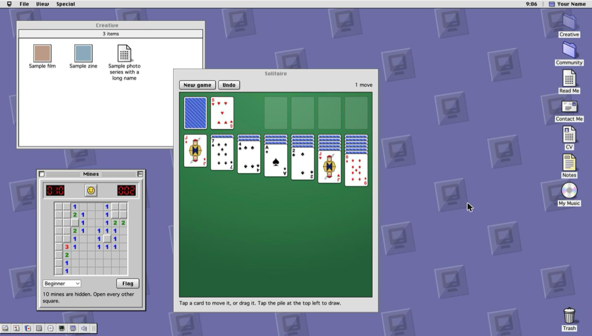

# Retro Desktop

A WordPress theme that turns a personal site into a late-1990s desktop computer: folders, files, windows, a menu bar, a few games, and sounds.

**See it running:** [celestinetan.com](https://celestinetan.com)

> Shared free and as is, with no warranty. Please read the [Disclaimer & Terms of Use](#disclaimer--terms-of-use) before you install it.

## What it does

1. Shows every address on your site as a desktop, with the right window already open. Links to a folder, a document or a note all work and can be shared.
2. Builds the desktop from ordinary WordPress content, so you keep it up to date in WordPress, not in code:
   - Portfolio project types become **folders**
   - Portfolio projects become **files** in those folders
   - Pages become **documents** on the desktop
   - Posts become **Notes**
3. Opens a page or project that holds a PDF as a document viewer, with a Download button. On phones the pages are drawn as pictures.
4. Turns a project that holds only one outside link into a **shortcut** that opens that site.
5. Draws the contact page as a new mail message, and plays YouTube links as songs in a music player.
6. Includes Paint, Mines, Solitaire, a sliding puzzle and a terminal.
7. Lets you, when logged in, write, edit, rename, upload and delete documents on the desktop itself, without opening the WordPress dashboard.
8. Gives phones their own layout: an icon grid and full-screen windows with a Back button.

A full guide for the site's owner is in [HOW-TO.md](HOW-TO.md).

## Requirements

- WordPress 6.4 or newer and PHP 7.4 or newer.
- A site where you can upload a theme: self-hosted WordPress, or WordPress.com on a plan with hosting features.
- The [Jetpack](https://wordpress.org/plugins/jetpack/) plugin is recommended. Its Form block provides the contact form, and its Portfolio feature provides projects and project types. Without Jetpack the theme registers the portfolio types itself, and the contact page shows whatever you put on it.

## Install

1. On this page choose **Code > Download ZIP**.
2. In WordPress go to **Appearance > Themes > Add New Theme > Upload Theme**, choose the ZIP and install it.
3. Activate **Retro Desktop**.
4. Go to **Settings > Permalinks** and press Save once, so the Notes, Trash and Music addresses work.
5. Add content:
   - a page with the address `read-me` introduces you and opens on a visitor's first visit;
   - a page whose address contains `contact`, holding a Form block, becomes the mail window;
   - project types under **Portfolio** become your folders.

To change the system's name on the start-up screen, edit one line near the top of `functions.php`: `define( 'PLATINUM_OS', 'RetroOS' );`. To use your own logo, replace the `mark` and `cel` drawings in `inc/icons.php`, or set a Site Icon in WordPress.

## Sources

Checked on 18 November 2026.

- Menus, window titles and buttons use **ChicagoFLF** by Robin Casady, a public-domain font, included in `assets/fonts` with its readme.
- PDFs on phones and tablets are drawn with **PDF.js** by Mozilla (Apache License 2.0), loaded from cdnjs when needed. It is not part of this repository.
- All icons, the logo, the card faces and the sounds are original. The sounds are generated by the visitor's browser; there are no audio files.
- The look is inspired by desktop computers of the late 1990s. No artwork, names, fonts or sounds from Apple, Microsoft or anyone else are included.

## Known limits

- Tested on one live site (WordPress.com with Jetpack). It has not been tested on a wide range of hosts, plugins or older browsers.
- There is no build step and no settings screen. A few choices, such as the system name, are made by editing a line of PHP.
- The desktop needs JavaScript. Without it the links still work, as ordinary pages.
- Music plays through YouTube's own player, so videos whose owners have switched off embedding will not play, and YouTube sets its own cookies.
- The owner's tools use the WordPress REST API with your logged-in session. They need a user who may edit pages and posts.
- Very large PDFs are slow on phones. Keep them under about 10 MB.
- Not translated yet; the text is in English.

## Disclaimer & Terms of Use

This theme is shared free of charge, for general use, and is provided "as is", without warranty of any kind. It is not professional technical, legal or security advice, and it comes with no promise that it is free of faults or suitable for your site.

You use it at your own risk. Back up your site before installing or changing a theme. To the fullest extent the law allows, the author accepts no liability for any direct or indirect loss or damage arising from its use, including loss of data, loss of income or downtime.

By using it you agree to hold the author harmless and not to bring claims against the author in connection with it, including claims made by third parties such as visitors to your site.

This is an unofficial, independent project. It is not affiliated with, or endorsed by, Apple, Microsoft, Automattic, WordPress, Google, YouTube, Mozilla or any other company named here. All trademarks belong to their owners.

Software and services change. The date above shows when the sources were last checked.

You may share and adapt the theme under the licence below, provided this section stays with it and changed versions are not presented as the author's own.

By using this theme, you accept these terms.

## Report a mistake

Open an issue on this repository, or write to hello@celestinetan.com.

## Licence

[MIT](LICENSE). Copyright (c) 2026 Celestine Tan. The font and PDF.js have their own terms, noted in the licence file.
